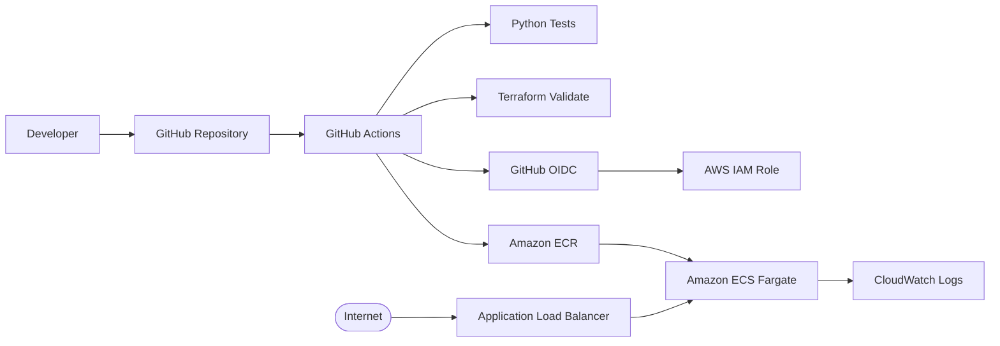

# Terraform + GitHub Actions + Amazon ECS Fargate CI/CD

> Containerized application platform demonstrating Terraform, Docker, Amazon ECR, ECS Fargate, Application Load Balancing, CloudWatch logging, and GitHub Actions with AWS OIDC.

## Executive summary

This project shows how to build a modern container delivery path on AWS without managing EC2 worker nodes.

A small Flask application is packaged as a Docker image, stored in Amazon ECR, and deployed to Amazon ECS on Fargate. Terraform manages the underlying AWS platform, while GitHub Actions provides automated testing and infrastructure validation. The deployment workflow is designed around GitHub's OIDC integration with AWS so the pipeline can use short-lived AWS credentials rather than storing long-lived access keys in GitHub secrets.

The project demonstrates the skills commonly expected from an AWS Cloud Engineer / DevOps Engineer: containerization, immutable deployments, infrastructure as code, CI/CD, IAM, networking, observability, and secure cloud authentication.

## Architecture



## Technology stack

- AWS VPC
- Application Load Balancer
- Amazon ECS Fargate
- Amazon ECR
- Amazon CloudWatch Logs
- AWS IAM
- Terraform
- Docker
- Python / Flask
- GitHub Actions
- GitHub OIDC

## Why Fargate?

ECS Fargate removes the need to manage the underlying EC2 container hosts. The team can focus on the container image, task definition, networking, scaling, and application lifecycle while AWS manages the server infrastructure.

## Repository structure

```text
.
├── .github/workflows/
│   └── ci-cd.yml
├── app/
│   ├── app.py
│   ├── Dockerfile
│   └── requirements.txt
├── infra/
│   ├── main.tf
│   ├── outputs.tf
│   └── variables.tf
├── bootstrap/
│   └── README.md
├── tests/
│   └── test_app.py
├── Makefile
├── SECURITY.md
├── docs.md
└── README.md
```

## CI/CD flow

### Pull request

Every pull request runs:

1. Python dependency installation.
2. Application unit tests.
3. `terraform fmt -check`.
4. `terraform init -backend=false`.
5. `terraform validate`.

### Push to `main`

After validation succeeds, the deployment job:

1. Requests a short-lived AWS session through GitHub OIDC.
2. Authenticates to Amazon ECR.
3. Builds the Docker image.
4. Tags the image with the Git commit SHA.
5. Pushes the image to ECR.
6. Runs Terraform to update the ECS service.

The workflow uses a GitHub `production` environment, giving the repository a clear place to add environment protection and approval rules.

## Important first-time bootstrap

The ECR repository is created by Terraform, so a completely new environment needs an initial infrastructure bootstrap before the first image push.

From `infra/`, authenticate to the target AWS account and run:

```bash
terraform init
terraform validate
terraform plan
terraform apply
```

The initial deployment uses the configured public container image as the task definition image. Once ECR exists, configure the GitHub OIDC role and repository variables, then use the GitHub Actions workflow for application image delivery.

> For a production implementation, separate the long-lived platform bootstrap/state resources from the application deployment state. This avoids a circular dependency between creating ECR and pushing the first application image.

## GitHub OIDC setup

Create an AWS IAM role that GitHub Actions can assume through OIDC. Restrict the role trust policy to the specific GitHub organization/repository and the intended branch or environment rather than allowing broad access.

Set this GitHub repository variable:

```text
AWS_ROLE_ARN=<the IAM role ARN>
```

The workflow requires:

```yaml
permissions:
  id-token: write
  contents: read
```

Do not store static AWS access keys in GitHub repository secrets for this deployment pattern.

## Local development

Run the Flask application locally:

```bash
python -m venv .venv
source .venv/bin/activate
pip install -r app/requirements.txt
python app/app.py
```

Test the application:

```bash
curl http://localhost:8080/health
curl http://localhost:8080/
```

Run tests:

```bash
pytest -q
```

Build the container:

```bash
docker build -t cloud-engineer-cicd app
```

Run it:

```bash
docker run --rm -p 8080:8080 cloud-engineer-cicd
```

## Security design

- AWS authentication from GitHub Actions uses OIDC and short-lived credentials.
- ECS tasks run in private subnets with no public IP addresses.
- The ALB is internet-facing and is the only intended public entry point.
- The ECS security group permits application traffic from the ALB security group.
- ECR has image scanning enabled on push.
- CloudWatch Logs retain application logs for a defined period.
- Infrastructure changes are reviewed through Git before deployment.

## Observability

Application logs are sent to CloudWatch Logs through the ECS `awslogs` driver. The ALB provides the entry point and health check used to determine whether ECS tasks are healthy.

For a production enhancement, add CloudWatch alarms, ECS service metrics, deployment failure alarms, and dashboards for latency, HTTP errors, CPU, and memory utilization.

## Validation checklist

Before calling the project complete, verify:

- [ ] Terraform validation passes.
- [ ] Unit tests pass.
- [ ] Docker image builds successfully.
- [ ] ECR contains the application image.
- [ ] ECS service reaches the desired task count.
- [ ] ALB target health is healthy.
- [ ] `/health` returns HTTP 200.
- [ ] Application logs appear in CloudWatch.
- [ ] GitHub Actions succeeds without static AWS credentials.
- [ ] The GitHub OIDC trust policy is scoped to the intended repository/environment.

## Cost awareness

Fargate, NAT Gateway, Application Load Balancer, and related AWS resources are billable. This repository is intended for development and interview demonstration purposes. Use the smallest practical task size, avoid leaving environments running unnecessarily, and destroy temporary environments when testing is complete.

## Interview questions this project prepares you for

**Why use OIDC instead of AWS access keys?**

OIDC allows GitHub Actions to exchange its identity token for short-lived AWS credentials. This reduces the need to store long-lived AWS secrets in the repository.

**Why deploy containers to private subnets?**

The application tasks do not need to accept inbound internet traffic. The ALB provides the public entry point, while private subnets reduce direct exposure of the workload.

**What happens during a deployment?**

The pipeline tests the application and Terraform configuration, builds a versioned image, publishes it to ECR, and updates the ECS task/service to use the new image.

**How would you make this production-ready?**

I would add remote Terraform state with locking, separate bootstrap and application states, stricter IAM permissions, environment approvals, automated image vulnerability gates, CloudWatch alarms, autoscaling policies, secrets management, and a documented rollback strategy.

## Well-Architected alignment

This project emphasizes operational excellence, security, reliability, performance efficiency, and cost awareness through automation, least-privilege-oriented access, private workloads, health checks, managed services, and repeatable infrastructure. AWS Well-Architected is organized around six pillars, including sustainability.

## Cleanup

```bash
cd infra
terraform destroy
```

Also verify that no ECR images, load balancers, NAT Gateway resources, or other billable resources remain.

## Portfolio talking points

- Built a containerized Flask service and deployed it to ECS Fargate.
- Provisioned networking, ECR, ECS, ALB, IAM, and CloudWatch with Terraform.
- Implemented GitHub Actions CI/CD with application testing and Terraform validation.
- Used GitHub OIDC to avoid long-lived AWS credentials in CI/CD.
- Applied immutable Git-SHA image tagging for traceable releases.
- Designed private application networking behind an internet-facing ALB.
